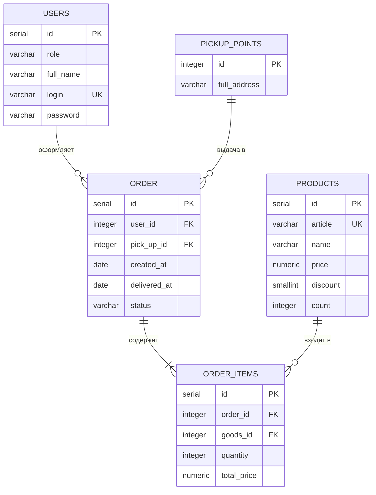

# ShoeShop — система оформления заказов обуви

Учебный проект: десктопное приложение для просмотра каталога обуви
и оформления заказов.

## Возможности

- просмотр каталога моделей обуви с ценой, скидкой и наличием;
- сортировка, фильтрация и поиск товаров;
- оформление заказа авторизованным пользователем;
- управление заказами (менеджер и администратор).

## Требования

- Python >= 3.14
- PostgreSQL >= 18
- PyQt6 >= 6.6
- psycopg2 >= 2.9
- Pillow >= 10.2

## Установка и запуск

1. Клонировать репозиторий: `git clone <адрес репозитория>`
2. Создать окружение и установить зависимости:
`python -m venv venv`, `venv\Scripts\activate`, `pip install -r requirements.txt`
3. Создать базу данных и загрузить скрипт `database/shoe_store.sql`.
4. Скопировать `config.ini.example` в `config.ini` и указать параметры подключения.
5. Запустить приложение: `python main.py`

## Структура репозитория

- `views/` — модули приложения
- `resources/` — изображения, логотип, иконка
- `database/` — скрипт базы данных
- `excel_data` - исходные данные

## ER-диаграмма базы данных

База данных `shoe_shop` приложения «Магазин обуви» (PostgreSQL) состоит из пяти таблиц. Схема создаётся скриптом `init_db.sql`.



### Таблицы

| Таблица | Назначение |
|---|---|
| `users` | Пользователи системы (роли: Администратор, Менеджер) |
| `products` | Каталог товаров: артикул, цена, скидка, остаток |
| `pickup_points` | Пункты выдачи заказов |
| `order` | Заказы: пользователь, пункт выдачи, даты, статус |
| `order_items` | Позиции заказа: товар, количество, сумма |

### Связи

- Один пользователь может оформить много заказов (`order.user_id`). При удалении пользователя поле принимает значение `NULL`.
- Один пункт выдачи используется во многих заказах (`order.pick_up_id`).
- Заказ состоит из одной или нескольких позиций (`order_items.order_id`). Позиции удаляются вместе с заказом.
- Один товар может входить во многие позиции (`order_items.goods_id`). Товар, который есть в заказах, удалить нельзя.

## Запуск PostgreSQL через Docker Compose

PostgreSQL и вспомогательный сервис `db-check` запускаются в контейнерах.
Само приложение запускается на хосте, как описано выше.

### Предварительные требования

- Docker Engine (или Docker Desktop) с Linux-контейнерами;
- Docker Compose v2;
- Git.

Проверка:

```bash
docker --version
docker compose version
docker info --format '{{.OSType}}'
```

### Настройка окружения

1. Скопировать шаблон переменных окружения:
   `cp .env.example .env` (в PowerShell: `Copy-Item .env.example .env`).
2. В `.env` заменить `POSTGRES_PASSWORD` на свой локальный пароль.
   Файл `.env` не должен попадать в Git.

### Запуск

```bash
docker compose config --quiet
docker compose up --build -d
docker compose ps
docker compose logs --tail=40 db-check
```

PostgreSQL должен быть в состоянии `healthy`. Сервис `db-check` — одноразовая
проверка, статус `Exited (0)` для него нормален.

### Импорт базы данных

```bash
docker compose cp database/shoe_store.sql db:/tmp/shoe_store.sql
docker compose exec db psql -v ON_ERROR_STOP=1 -U shoe_user -d shoe_store -f /tmp/shoe_store.sql
```

Импорт выполняется один раз.

### Подключение приложения

В `config.ini` указать:

```ini
[database]
host = localhost
port = 5433
name = shoe_store
user = shoe_user
password = <пароль из .env>
```

Внутри Compose сервис `db-check` обращается к базе по адресу `db:5432`,
приложение на хосте — по `localhost:5433`.

### Проверка

```bash
docker compose exec db pg_isready -U shoe_user -d shoe_store
docker compose run --rm db-check
```

Ожидается строка `OK: база=shoe_store; таблиц=<число больше 0>`.

### Остановка

```bash
docker compose stop     # остановить
docker compose start    # запустить снова
```

> Не используйте `docker compose down -v`: том с данными PostgreSQL в этой
> конфигурации не настроен, и данные могут быть потеряны.

## Автор

Татаринцев Олег, ЩПКО-03-23
