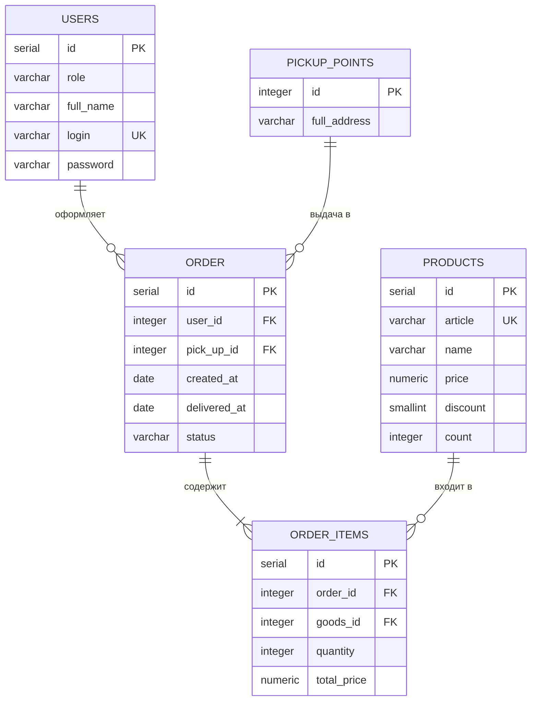

# ShoeShop — система оформления заказов обуви

Учебный проект: десктопное приложение для просмотра каталога обуви
и оформления заказов.

## Возможности

- просмотр каталога моделей обуви с ценой, скидкой и наличием;
- сортировка, фильтрация и поиск товаров;
- оформление заказа авторизованным пользователем;
- управление заказами (менеджер и администратор).

## Требования

- Python >= 3.14
- PostgreSQL >= 18
- PyQt6 >= 6.6
- psycopg2 >= 2.9
- Pillow >= 10.2

## Установка и запуск

1. Клонировать репозиторий: `git clone <адрес репозитория>`
2. Создать окружение и установить зависимости:
`python -m venv venv`, `venv\Scripts\activate`, `pip install -r requirements.txt`
3. Создать базу данных и загрузить скрипт `database/shoe_store.sql`.
4. Скопировать `config.ini.example` в `config.ini` и указать параметры подключения.
5. Запустить приложение: `python main.py`

## Структура репозитория

- `views/` — модули приложения
- `resources/` — изображения, логотип, иконка
- `database/` — скрипт базы данных
- `excel_data` - исходные данные

## ER-диаграмма базы данных

База данных `shoe_shop` приложения «Магазин обуви» (PostgreSQL) состоит из пяти таблиц. Схема создаётся скриптом `init_db.sql`.

### Таблицы

| Таблица | Назначение |
|---|---|
| `users` | Пользователи системы (роли: Администратор, Менеджер) |
| `products` | Каталог товаров: артикул, цена, скидка, остаток |
| `pickup_points` | Пункты выдачи заказов |
| `order` | Заказы: пользователь, пункт выдачи, даты, статус |
| `order_items` | Позиции заказа: товар, количество, сумма |

### Связи

- Один пользователь может оформить много заказов (`order.user_id`). При удалении пользователя поле принимает значение `NULL`.
- Один пункт выдачи используется во многих заказах (`order.pick_up_id`).
- Заказ состоит из одной или нескольких позиций (`order_items.order_id`). Позиции удаляются вместе с заказом.
- Один товар может входить во многие позиции (`order_items.goods_id`). Товар, который есть в заказах, удалить нельзя.

## Автор

Татаринцев Олег, ЩПКО-03-23
